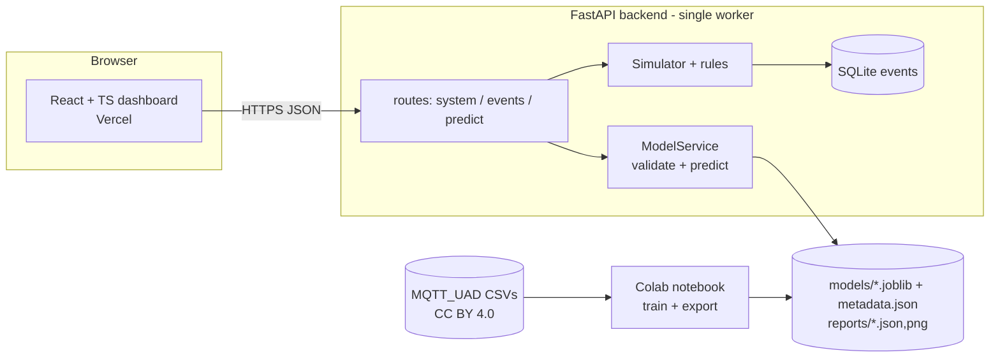
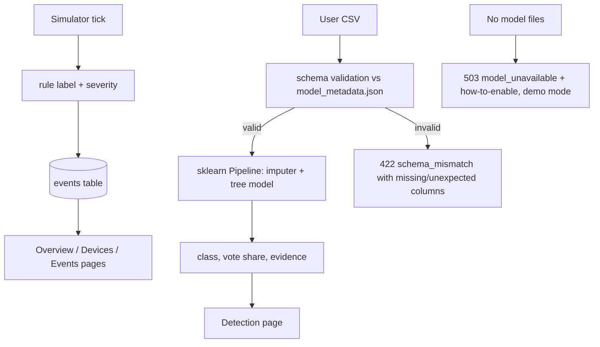

# Architecture, problem statement and objectives

## Problem statement
Consumer smart homes (locks, cameras, lights, HVAC) talk MQTT through a broker. Weak or absent broker authentication allows brute force, topic enumeration, flooding and takeover (see the Smart Home poster's kill chain). Home users have no SOC; they need automated detection that is honest about its limits.

## Research objectives
1. Build a reproducible ML pipeline that classifies MQTT network-frame feature rows (normal, DoS, MitM, intrusion) from a public dataset.
2. Evaluate it without leakage and report per-class errors, false-positive/negative rates and latency, not accuracy alone.
3. Serve it behind a validated API and a dashboard that separates real inference from simulation.
4. Keep the design ready for a later VAPT module.

## Architecture

## Data flow

## Module boundaries (for future work)
`ml_service.py` (framework-free), `simulator.py`, `store.py`, `simulation.py`, thin routers, typed contracts in `schemas.py` ↔ `frontend/src/types/api.ts`. New detectors, ingestion or VAPT plug in as new services plus routers without touching existing pages.
